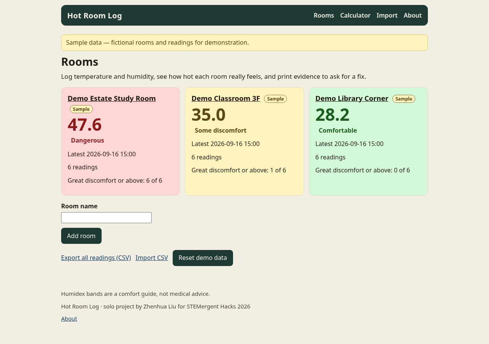
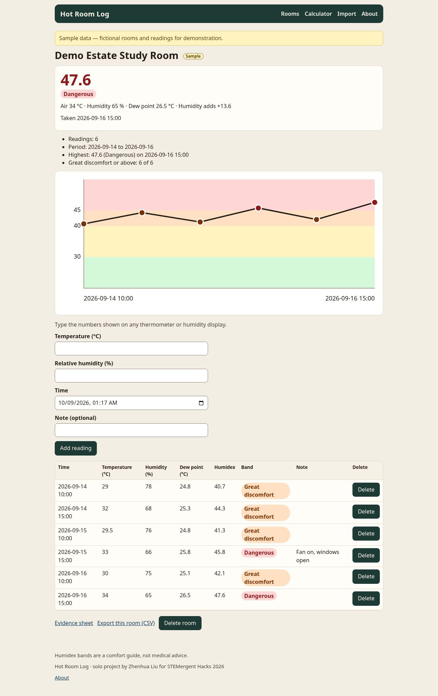
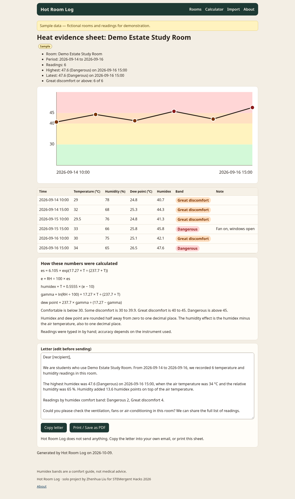
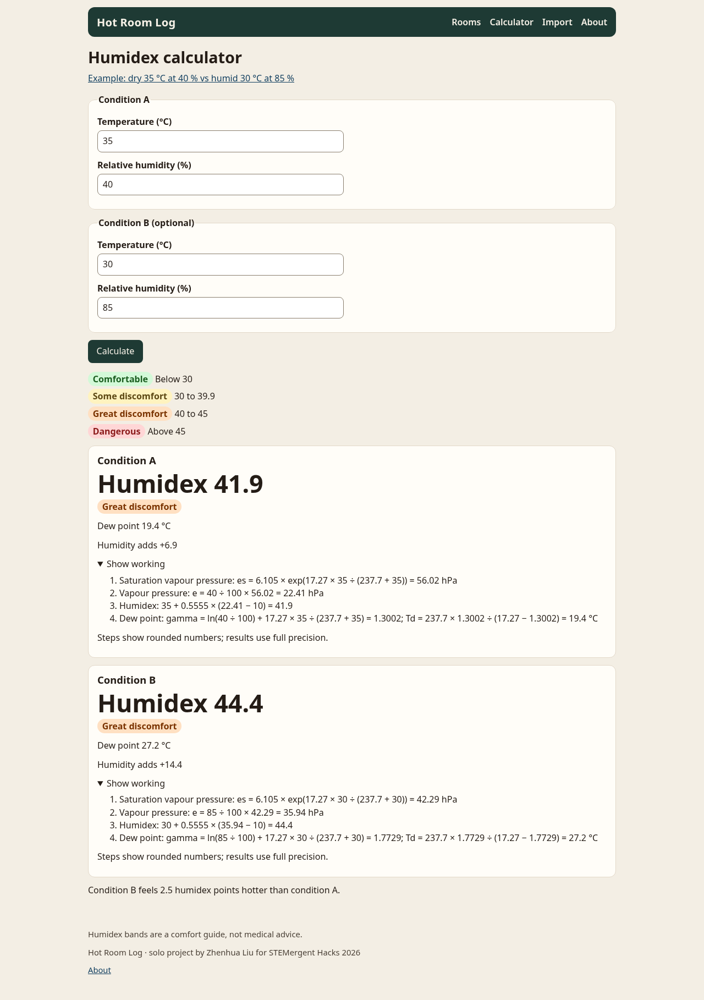
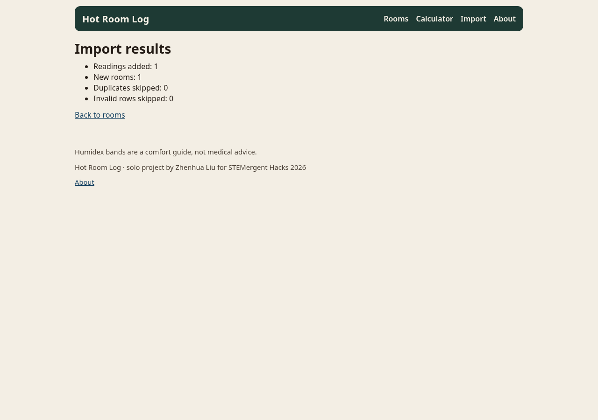

# Hot Room Log

Hot Room Log is a small local web app for a student, class monitor, or volunteer who wants a shared room to be more comfortable to study in. You type the temperature and relative humidity from any thermometer or humidity display. The app shows the humidex, the dew point, and how much the humidity adds, charts the room over time, and builds a printable evidence sheet with a polite letter you can edit, copy, or print. Nothing is sent anywhere. There is no account and no login.

## Quick start

```
python -m venv .venv
source .venv/bin/activate          (Windows: .venv\Scripts\activate)
pip install -r requirements.txt
python app.py                      -> http://127.0.0.1:5050
```

Flask is the only runtime dependency. The first start creates `instance/hotroom.db` and loads the sample rooms. Later starts keep your data. There is no login.

Tests: `pip install -r requirements-dev.txt`, then `pytest`.

Optional environment variables:

| Variable | Default | Effect |
|---|---|---|
| `PORT` | `5050` | Port used by `python app.py` |
| `HOST` | `127.0.0.1` | Bind address. The app is local-only unless you change this |
| `HOTROOM_DB` | `instance/hotroom.db` | SQLite file path |
| `HOTROOM_READONLY` | unset | Set to `1` for a read-only demo (view, calculate, and export still work). Use this for any public link |
| `SECRET_KEY` | random at each start | Signs the cookie used for one-line confirmation messages |

## Features

- Hand-logged temperature and humidity for each room, with validation and duplicate room names rejected
- Humidex, dew point, humidity effect, and a comfort band on every reading
- Inline SVG chart and a readings table
- Printable evidence sheet with an editable letter, copy, and print. Editing the letter updates what is printed, including the browser's own print command
- Calculator that shows the working for one or two conditions
- CSV export and import, including round-trip of an export file
- Reset back to the labelled sample data
- Optional read-only demo mode
- JSON API for readings (`GET /api/humidex`, `GET /api/rooms`, `GET /api/rooms/<id>/readings`, `POST /api/rooms/<id>/readings`)

All rooms and readings in the demo are fictional sample data.

A public or shared demo must be started with `HOTROOM_READONLY=1`. Visitors can still calculate, read the charts, open an evidence sheet, and export CSV. Adding, deleting, importing, and resetting are turned off. The app binds to `127.0.0.1` unless `HOST` is changed. There is no CSRF token; read-only mode is the safe way to put it on a network.

## Screenshots

Dashboard with the three sample rooms:



Demo Estate Study Room, including the humidex chart:



Evidence sheet and letter:



Calculator comparing a dry 35 °C at 40 % with a humid 30 °C at 85 %, with the working open:



CSV import results:



The delivery demo for submission is hot-room-log-demo-v4.mp4 (1920×1080, duration 152.067 seconds). The voice-over is an AI-generated voice (Alibaba Cloud Model Studio text-to-speech, qwen3-tts-flash, voice Cherry), with burned-in English captions. The running app does not call that service. A check that lines the speech up with the scene cues is in [docs/narration-check.md](docs/narration-check.md). Public video URL: TBD.

## Formulas

T is the air temperature in °C. RH is the relative humidity in %.

```
es = 6.105 × exp(17.27 × T ÷ (237.7 + T))
e = RH ÷ 100 × es
humidex = T + 0.5555 × (e − 10)
gamma = ln(RH ÷ 100) + 17.27 × T ÷ (237.7 + T)
dew point = 237.7 × gamma ÷ (17.27 − gamma)
```

Humidex and dew point are rounded half away from zero to one decimal place. The humidity effect is that rounded humidex minus the air temperature, also to one decimal place. It can be negative when the air is very dry.

Bands use the rounded humidex: below 30 Comfortable, 30 to 39.9 Some discomfort, 40 to 45 Great discomfort, above 45 Dangerous. The bands are a comfort guide, not medical advice. Humidex ignores sun, wind, clothing, and activity.

The humidex definition `T + 0.5555 × (e − 10)` is the Canadian humidex (Masterton & Richardson, 1979, Environment Canada). The vapour-pressure line is a Magnus-type approximation with constants 6.105 hPa, 17.27, and 237.7 °C. The dew point is the inverse of that same formula.

## AI tools and third-party resources

- Running app, third-party resources: Flask and its dependencies (Werkzeug, Jinja2, MarkupSafe, ItsDangerous, Click, Blinker) and pytest. The pages use the system font stack. The running app has no third-party images, fonts, or icons: no font files, no icon font, and no chart library. That sentence is about the running app only. It does not describe the demo video pipeline.
- Formula sources: the Canadian humidex (Masterton & Richardson, 1979, Environment Canada) and the Magnus-type approximation above.
- AI tools and the demo: Grok (xAI) wrote the application code and tests, the docs, the screenshots, the demo recording scripts, and the demo's narration text and captions. Claude (Anthropic) drafted the planning documents (the idea, the requirements, and the QA plan). The demo video's voice-over is an AI-generated voice from Alibaba Cloud Model Studio (DashScope/Bailian) text-to-speech: model qwen3-tts-flash, voice Cherry. It was used only to make the video. The running app does not call DashScope or any other external service, and needs no API key. Playwright, Google Chrome, ffmpeg, and the DejaVu Sans font were used to produce the demo. Zhenhua reviews this list before submission.

## Honesty

The sample rooms and readings are fictional. They are not measurements of any real room. Hot Room Log is not deployed at, endorsed by, or used by any school, estate, or organisation. This is a solo project by Zhenhua Liu for STEMergent Hacks 2026, Hackathon pathway. Export a CSV if you want a copy of your own readings before using Reset demo data.

## Submission draft

Paste-ready Devpost text, with the AI disclosure filled in for the tools used on this build, is in [docs/devpost.md](docs/devpost.md). Do not submit before the Devpost form is open. "Challenges" and "What I learned" are left for Zhenhua to write from the build.

## Licence

MIT. Copyright (c) 2026 Zhenhua Liu. See [LICENSE](LICENSE).
